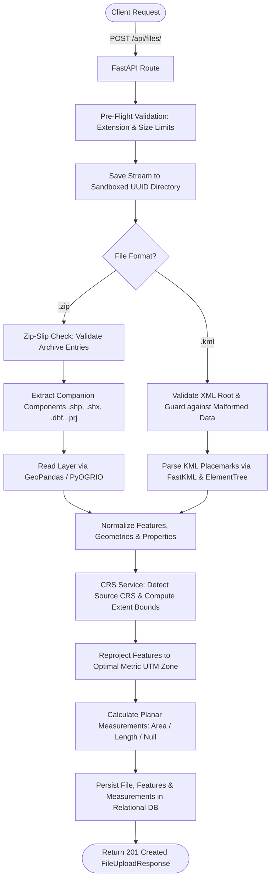
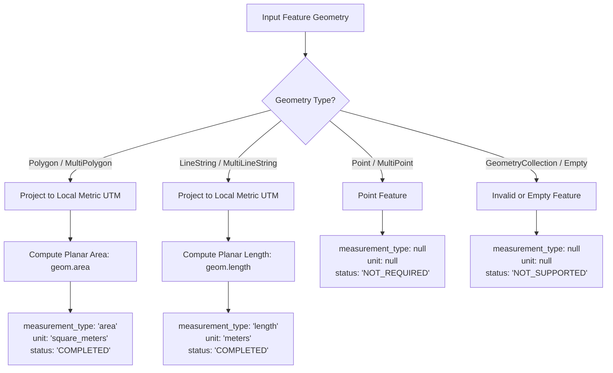

# Geospatial File Measurement API

A production-grade, modular backend REST API built with **FastAPI**, **GeoPandas**, **Shapely**, **PyProj**, and **SQLAlchemy 2.x**. It accepts geospatial files (**ESRI Shapefile ZIP archives** and **KML files**), validates geometries, detects Coordinate Reference Systems (CRS), transforms coordinates into optimal metric projected coordinate systems (UTM), and calculates planar measurements (**Polygon area** in $m^2$ and **LineString length** in meters).

---

## 🌐 Live Deployed Application

> **Production Base URL**: [https://geospatial-measurement-api-mvz4.onrender.com](https://geospatial-measurement-api-mvz4.onrender.com)

### Quick Links to Live Services & Endpoints

| Resource | Live Link | Method | Description |
| :--- | :--- | :---: | :--- |
| **Interactive Web UI** | [Live Studio UI](https://geospatial-measurement-api-mvz4.onrender.com/ui) | `GET` | Web interface with Leaflet map, file dropzone, and measurement tables |
| **Swagger UI Docs** | [Live Swagger Docs](https://geospatial-measurement-api-mvz4.onrender.com/docs) | `GET` | Interactive OpenAPI documentation & API test console |
| **ReDoc Documentation** | [Live ReDoc](https://geospatial-measurement-api-mvz4.onrender.com/redoc) | `GET` | Comprehensive API specifications and schemas |
| **Health Check** | [Live Health Endpoint](https://geospatial-measurement-api-mvz4.onrender.com/api/health) | `GET` | Service status and database connectivity check |
| **List Files** | [Live List Files](https://geospatial-measurement-api-mvz4.onrender.com/api/files/?skip=0&limit=50) | `GET` | Paginated list of uploaded geospatial files |
| **Upload File** | `https://geospatial-measurement-api-mvz4.onrender.com/api/files/` | `POST` | Multipart upload for Shapefile (`.zip`) or KML (`.kml`) |
| **File Metadata** | `https://geospatial-measurement-api-mvz4.onrender.com/api/files/{id}/` | `GET` | Detailed metadata and processing status by file ID |
| **File Measurements** | `https://geospatial-measurement-api-mvz4.onrender.com/api/files/{id}/measurements/` | `GET` | Computed metric measurements and feature properties |

---

## Table of Contents

1. [Architecture](#architecture)
   - [Application Structure](#application-structure)
   - [File-Processing Flow](#file-processing-flow)
   - [Measurement Calculation Flow](#measurement-calculation-flow)
   - [CRS Handling & Projection Strategy](#crs-handling--projection-strategy)
2. [API Documentation](#api-documentation)
   - [Endpoints Specification](#endpoints-specification)
   - [Standard Error Envelope](#standard-error-envelope)
3. [Setup & Local Development](#setup--local-development)
   - [Prerequisites](#prerequisites)
   - [Local Environment Setup](#local-environment-setup)
   - [Running with Docker](#running-with-docker)
   - [Running Tests](#running-tests)
4. [Design Decisions & Alternatives](#design-decisions--alternatives)
5. [Key Learnings](#key-learnings)
6. [Future Scope](#future-scope)

---

## Architecture

### Application Structure

The application follows clean architectural principles with strict separation between routing, business logic, data persistence, and schemas:

```text
geospatial-file-measurement-api/
├── app/
│   ├── main.py                  # FastAPI initialization, middleware, routes, and exception handlers
│   ├── api/
│   │   ├── dependencies.py      # Database session dependency injection
│   │   └── routes/
│   │       ├── files.py         # File upload and listing endpoints
│   │       ├── measurements.py  # Geometric measurement query endpoints
│   │       └── health.py        # System health and database verification
│   ├── core/
│   │   ├── config.py            # Pydantic Settings v2 environment configurations
│   │   ├── exceptions.py        # Domain-specific exception definitions
│   │   └── logging.py           # Structured application logging
│   ├── db/
│   │   └── session.py           # SQLAlchemy 2.0 database engine & session maker
│   ├── models/                  # SQLAlchemy ORM declarative models (Files, Features, Measurements)
│   ├── repositories/            # Database query encapsulation (FileRepository, MeasurementRepository)
│   ├── schemas/                 # Pydantic v2 request & response validation schemas
│   ├── services/                # Domain logic (FileService, GeospatialService, CRSService, MeasurementService)
│   ├── static/                  # Web Studio UI (HTML5, Vanilla CSS, Leaflet JS)
│   └── utils/                   # File security validation, Zip-Slip prevention, XML guards
├── data/
│   ├── sample_data/             # Test geospatial datasets (.kml, .zip)
│   ├── uploads/                 # Upload directory (isolated UUID subdirectories)
│   └── temp/                    # Temporary extraction directory (auto-cleaned)
├── tests/                       # Automated pytest suite (40 unit & integration tests)
├── Dockerfile                   # Container definition (dynamic $PORT support for Render)
├── docker-compose.yml           # Multi-container local orchestration
├── render.yaml                  # Render Infrastructure-as-Code deployment blueprint
└── requirements.txt             # Locked project dependencies
```

---

### File-Processing Flow



---

### Measurement Calculation Flow

Calculations are performed strictly on **projected 2D Cartesian coordinates** to guarantee physically meaningful metric units:



---

### CRS Handling & Projection Strategy

1. **Why Coordinate Transformation is Mandatory**:
   Geospatial datasets frequently use geographic coordinates such as **WGS 84 (`EPSG:4326`)**, where points are expressed in angular degrees ($^\circ$) of latitude and longitude. Calculating geometric area or distance directly on angular coordinates produces physically meaningless units (e.g., "square degrees") and large scale distortions.
2. **Dynamic Centroid-Based UTM Selection**:
   The `CRSService` calculates the dataset's geographic centroid $(\text{longitude}, \text{latitude})$ and dynamically derives the corresponding Universal Transverse Mercator (UTM) zone:
   $$\text{Zone} = \left\lfloor \frac{\text{longitude} + 180}{6} \right\rfloor + 1$$
   - Northern Hemisphere ($\text{lat} \ge 0$): $\text{EPSG:32600} + \text{Zone}$ (e.g., EPSG:32643 for Bengaluru, EPSG:32633 for Berlin).
   - Southern Hemisphere ($\text{lat} < 0$): $\text{EPSG:32700} + \text{Zone}$ (e.g., EPSG:32756 for Sydney).
   - Polar Regions ($|\text{lat}| > 84^\circ$): Automatically routed to Universal Polar Stereographic (UPS North `EPSG:32661` or UPS South `EPSG:32761`).
3. **High-Performance Transformation**:
   Coordinates are projected via `pyproj.Transformer.from_crs(source_crs, target_crs, always_xy=True)` integrated with `shapely.ops.transform`.

---

## API Documentation

### Endpoints Specification

#### 1. Upload & Process Geospatial File
- **Method**: `POST`
- **Path**: `/api/files/`
- **Live URL**: `https://geospatial-measurement-api-mvz4.onrender.com/api/files/`
- **Payload**: `multipart/form-data` with parameter `file` (`.zip` Shapefile or `.kml`).

**Example Request**:
```bash
curl -X POST "https://geospatial-measurement-api-mvz4.onrender.com/api/files/" \
  -H "accept: application/json" \
  -H "Content-Type: multipart/form-data" \
  -F "file=@bengaluru_parks.kml"
```

**Example Response (`201 Created`)**:
```json
{
  "id": "d93b39ae-f17b-4225-9299-d54e7990c31d",
  "filename": "bengaluru_parks.kml",
  "file_type": "KML",
  "file_size": 1206,
  "feature_count": 3,
  "crs": "EPSG:4326",
  "source_crs": "EPSG:4326",
  "measurement_crs": "EPSG:32643",
  "status": "COMPLETED",
  "uploaded_at": "2026-10-11T12:00:00.000000Z",
  "processed_at": "2026-10-11T12:00:00.120000Z"
}
```

---

#### 2. Get File Information
- **Method**: `GET`
- **Path**: `/api/files/{id}/`
- **Live URL Format**: `https://geospatial-measurement-api-mvz4.onrender.com/api/files/{id}/`

**Example Request**:
```bash
curl -X GET "https://geospatial-measurement-api-mvz4.onrender.com/api/files/d93b39ae-f17b-4225-9299-d54e7990c31d/" \
  -H "accept: application/json"
```

**Example Response (`200 OK`)**:
```json
{
  "id": "d93b39ae-f17b-4225-9299-d54e7990c31d",
  "filename": "bengaluru_parks.kml",
  "file_type": "KML",
  "file_size": 1206,
  "feature_count": 3,
  "crs": "EPSG:4326",
  "source_crs": "EPSG:4326",
  "measurement_crs": "EPSG:32643",
  "status": "COMPLETED",
  "uploaded_at": "2026-10-11T12:00:00.000000Z",
  "processed_at": "2026-10-11T12:00:00.120000Z",
  "error_message": null
}
```

---

#### 3. Get File Measurements
- **Method**: `GET`
- **Path**: `/api/files/{id}/measurements/`
- **Live URL Format**: `https://geospatial-measurement-api-mvz4.onrender.com/api/files/{id}/measurements/`

**Example Request**:
```bash
curl -X GET "https://geospatial-measurement-api-mvz4.onrender.com/api/files/d93b39ae-f17b-4225-9299-d54e7990c31d/measurements/" \
  -H "accept: application/json"
```

**Example Response (`200 OK`)**:
```json
{
  "file_id": "d93b39ae-f17b-4225-9299-d54e7990c31d",
  "filename": "bengaluru_parks.kml",
  "feature_count": 3,
  "source_crs": "EPSG:4326",
  "measurement_crs": "EPSG:32643",
  "measurements": [
    {
      "feature_id": 0,
      "geometry_type": "Polygon",
      "measurement_type": "area",
      "value": 300416.8891,
      "unit": "square_meters",
      "status": "COMPLETED",
      "properties": {
        "Name": "Cubbon Park Polygon",
        "description": "Urban green park in Bengaluru"
      }
    },
    {
      "feature_id": 1,
      "geometry_type": "LineString",
      "measurement_type": "length",
      "value": 506.981,
      "unit": "meters",
      "status": "COMPLETED",
      "properties": {
        "Name": "Kasturba Road Walkway"
      }
    },
    {
      "feature_id": 2,
      "geometry_type": "Point",
      "measurement_type": null,
      "value": null,
      "unit": null,
      "status": "NOT_REQUIRED",
      "properties": {
        "Name": "Bandstand Landmark"
      }
    }
  ]
}
```

---

#### 4. List Files (Paginated)
- **Method**: `GET`
- **Path**: `/api/files/?skip=0&limit=50`
- **Live URL**: [https://geospatial-measurement-api-mvz4.onrender.com/api/files/?skip=0&limit=50](https://geospatial-measurement-api-mvz4.onrender.com/api/files/?skip=0&limit=50)

**Example Response (`200 OK`)**:
```json
{
  "total": 1,
  "items": [
    {
      "id": "d93b39ae-f17b-4225-9299-d54e7990c31d",
      "filename": "bengaluru_parks.kml",
      "file_type": "KML",
      "feature_count": 3,
      "source_crs": "EPSG:4326",
      "measurement_crs": "EPSG:32643",
      "status": "COMPLETED"
    }
  ]
}
```

---

#### 5. Health Check
- **Method**: `GET`
- **Path**: `/api/health`
- **Live URL**: [https://geospatial-measurement-api-mvz4.onrender.com/api/health](https://geospatial-measurement-api-mvz4.onrender.com/api/health)

**Example Response (`200 OK`)**:
```json
{
  "status": "online",
  "database": "healthy",
  "version": "1.0.0"
}
```

---

### Standard Error Envelope

All API errors return a uniform, machine-readable JSON envelope:

```json
{
  "error": {
    "code": "UNSUPPORTED_FILE_TYPE",
    "message": "Unsupported file type '.txt'. Only .zip Shapefile archives and .kml files are accepted.",
    "details": {
      "supported_extensions": [".zip", ".kml"],
      "provided_extension": ".txt"
    }
  }
}
```

| HTTP Status | Error Code | Cause |
| :---: | :--- | :--- |
| `400 Bad Request` | `EMPTY_FILE` | Uploaded file size is 0 bytes. |
| `400 Bad Request` | `UNSUPPORTED_FILE_TYPE` | Extension is not `.zip` or `.kml`. |
| `400 Bad Request` | `CORRUPTED_ARCHIVE` | Invalid or unreadable ZIP archive. |
| `400 Bad Request` | `PATH_TRAVERSAL_DETECTED` | Archive contains Zip-Slip relative paths. |
| `400 Bad Request` | `INVALID_SHAPEFILE` | Missing `.shp`, multiple `.shp`, or missing `.shx`/`.dbf`. |
| `400 Bad Request` | `INVALID_KML` | Malformed XML or missing KML root document. |
| `404 Not Found` | `NOT_FOUND` | Specified file ID does not exist in the database. |
| `413 Payload Too Large` | `FILE_SIZE_EXCEEDED` | File size exceeds configured maximum (50 MB). |
| `422 Unprocessable` | `CRS_PROCESSING_ERROR` | Coordinate system transformation or unresolvable CRS. |
| `422 Unprocessable` | `GEOSPATIAL_PROCESSING_ERROR` | Corrupted spatial geometries or feature parsing error. |

---

## Setup & Local Development

### Prerequisites
- Python **3.10+**
- Git

### Local Environment Setup

1. **Clone the repository**:
   ```bash
   git clone https://github.com/surhendhaar07/geospatial-file-measurement-api.git
   cd geospatial-file-measurement-api
   ```

2. **Create and activate a virtual environment**:
   - **Linux / macOS**:
     ```bash
     python3 -m venv .venv
     source .venv/bin/activate
     ```
   - **Windows (PowerShell)**:
     ```powershell
     python -m venv .venv
     .\.venv\Scripts\Activate.ps1
     ```

3. **Install dependencies**:
   ```bash
   pip install --upgrade pip
   pip install -r requirements.txt
   ```

4. **Environment configuration**:
   ```bash
   cp .env.example .env
   ```

5. **Run the development server**:
   ```bash
   uvicorn app.main:app --reload --host 0.0.0.0 --port 8000
   ```

Access the local services:
- **Web UI**: [http://localhost:8000/ui](http://localhost:8000/ui)
- **Swagger Docs**: [http://localhost:8000/docs](http://localhost:8000/docs)
- **Health Check**: [http://localhost:8000/api/health](http://localhost:8000/api/health)

---

### Running with Docker

Build and run the container locally:

```bash
docker compose up --build
```

The container automatically maps port `8000:8000` and configures local persistence volumes.

---

### Running Tests

Execute the complete test suite (40 unit and integration tests):

```bash
pytest -v
```

Execute the live end-to-end integration test runner:

```bash
python scripts/verify_api_live.py
```

---

## Design Decisions & Alternatives

| Decision | Implementation | Alternatives Considered & Rationale |
| :--- | :--- | :--- |
| **Framework** | **FastAPI 0.110+** | *Flask / Django*: Flask lacks native async streaming for large uploads and requires extra libraries for OpenAPI. Django is unnecessarily heavy for a dedicated measurement microservice. FastAPI provides native OpenAPI, Pydantic v2 validation, and async I/O. |
| **Geospatial Engine** | **GeoPandas & PyOGRIO** | *Raw GDAL (`osgeo.ogr`)*: Raw GDAL has fragile bindings, steep memory management overhead in Python, and complicated platform compilation. GeoPandas with PyOGRIO provides vectorized C-level performance with Pythonic simplicity. |
| **Projection Strategy** | **Centroid-Based UTM** | *Web Mercator (`EPSG:3857`)*: Web Mercator introduces severe areal distortion away from the equator (Greenland effect). Centroid-based UTM keeps local scale error $\le 0.1\%$, producing authoritative metric units ($m$ and $m^2$). |
| **Database Architecture** | **SQLAlchemy 2.0 ORM** | *Direct PostGIS dependency*: Mandating PostGIS introduces heavy infrastructure requirements. The current architecture uses SQLAlchemy abstractions with standard types, allowing zero-dependency local SQLite execution and seamless PostgreSQL portability (`DATABASE_URL`). |
| **Upload Security** | **Sandboxing & Zip-Slip Defense** | Files are extracted into isolated UUID directories. Every archive member is verified using `os.path.commonpath` to eliminate path traversal attacks, and temp files are cleaned up in `finally` blocks. |
| **Geometry Handling** | **Graceful Status Model** | Rather than failing an entire file when encountering unsupported or non-measurable geometries (e.g. Points, MultiPoints), the system marks them `NOT_REQUIRED` or `NOT_SUPPORTED` and proceeds with calculating all valid features. |

---

## Key Learnings

1. **Geodetic vs. Planar Spatial Computation**: Direct Euclidean calculations on spherical coordinates (`EPSG:4326`) yield inaccurate, non-physical units ("square degrees"). Proper spatial engineering requires selecting regional conformal projected systems (UTM) based on geographic centroid coordinates.
2. **Defensive Archive Ingestion**: Handling multi-file geospatial bundles (Shapefile `.shp`, `.shx`, `.dbf`, `.prj`) requires strict pre-extraction inspection to defend against Zip-Slip traversal, memory exhaustion, and missing companion components.
3. **Pydantic v2 & FastAPI Production Patterns**: Leveraging typed response schemas, structured error envelopes, and automated OpenAPI documentation ensures predictable client-server contracts.
4. **Resilient XML/KML Parsing**: Accounting for variations across KML namespace implementations (KML 2.2 schemas, nested Placemarks, and ExtendedData attributes) requires multi-tiered fallback strategies.

---

## Future Scope

1. **Additional Geospatial Formats**: Extend ingestion to GeoJSON, GeoPackage (`.gpkg`), FlatGeobuf, and CAD DXF.
2. **Asynchronous Background Processing**: Introduce Celery or ARQ with Redis queues for long-running processing of multi-gigabyte spatial archives.
3. **Native PostGIS Spatial Indexing**: Add PostGIS geometry columns with GiST spatial indexing for spatial query support (bounding box search, point-in-polygon, buffer intersection).
4. **Direct Cloud Object Storage**: Support presigned direct uploads to AWS S3, Google Cloud Storage, or Azure Blob Storage.
5. **Advanced Vector Geoprocessing**: Support convex hull generation, polygon simplification (Douglas-Peucker), and automated geometry repair.
